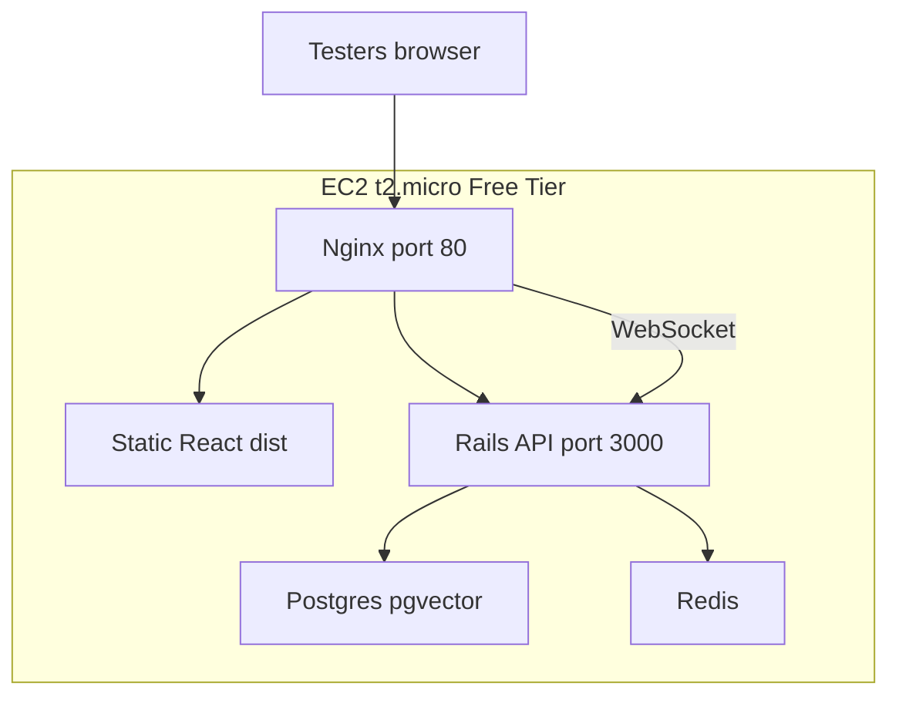

# ExpertHub on AWS Free Tier — Step-by-Step Guide

No custom domain required — use [nip.io](https://nip.io) with your Elastic IP for multi-tenant subdomains.

## Architecture



| Service | Image / build | Role |
|---------|---------------|------|
| `postgres` | `ankane/pgvector` | DB + pgvector |
| `redis` | `redis:7-alpine` | ActionCable |
| `api` | Dockerfile | Rails on port 3000 |
| `nginx` | `nginx:alpine` | SPA + API proxy |

## nip.io (no domain needed)

If your Elastic IP is `54.123.45.67`:

| Elastic IP | APP_DOMAIN |
|------------|------------|
| `54.123.45.67` | `54-123-45-67.nip.io` |

- `54-123-45-67.nip.io` → platform signup
- `sosmydoctor.54-123-45-67.nip.io` → tenant marketplace
- `fitnesszone.54-123-45-67.nip.io` → another tenant

Set `FORCE_SSL=false` — HTTP only until you add a domain + HTTPS.

---

## Phase 0 — Before AWS (on your Mac)

### 0.1 Push latest code to GitHub

Merge the AWS deploy PR so the server can `git clone` the latest.

### 0.2 Generate secrets (never commit)

```bash
cd experthub-api
cat config/master.key                    # → RAILS_MASTER_KEY
openssl rand -hex 64                     # → DEVISE_JWT_SECRET_KEY
bin/rails db:encryption:init             # → 3 ACTIVE_RECORD_ENCRYPTION_* keys
```

---

## Phase 1 — Create AWS account (~15 min)

1. [aws.amazon.com/free](https://aws.amazon.com/free) → **Create an AWS Account**
2. Verify phone; add payment method (identity only — stay in Free Tier)
3. Choose **Basic support (free)**
4. Pick a region (e.g. **ap-south-1** or **us-east-1**) and stick to it

**Billing alarm (recommended):**

- Billing → preferences → enable **Free Tier alerts**
- CloudWatch → alarm on **EstimatedCharges** > $1

---

## Phase 2 — Launch EC2 (~15 min)

Console → **EC2** → **Launch instance**

| Setting | Value |
|---------|--------|
| Name | `experthub-demo` |
| AMI | Ubuntu Server 22.04 LTS |
| Instance type | t2.micro or t3.micro |
| Key pair | Create new → download `.pem` |
| Storage | 30 GiB gp3 |

**Security group `experthub-sg`:**

| Type | Port | Source |
|------|------|--------|
| SSH | 22 | My IP only |
| HTTP | 80 | 0.0.0.0/0 |

Do **not** expose Postgres (5432) or Redis (6379).

**Elastic IP:** EC2 → Elastic IPs → Allocate → Associate with instance. Note the IP.

---

## Phase 3 — Bootstrap server (~20 min)

```bash
chmod 400 ~/Downloads/experthub-demo.pem
ssh -i ~/Downloads/experthub-demo.pem ubuntu@YOUR_ELASTIC_IP
```

On the server:

```bash
git clone https://github.com/abhimanyu1855/experthub-api.git
cd experthub-api
bash deploy/bootstrap-server.sh
# Log out and back in so docker group applies
exit
ssh -i ~/Downloads/experthub-demo.pem ubuntu@YOUR_ELASTIC_IP
```

---

## Phase 4 — Deploy stack (~30 min)

```bash
cd ~
git clone https://github.com/abhimanyu1855/experthub-web.git

cd ~/experthub-api
./deploy/setup-env.sh YOUR_ELASTIC_IP
nano .env.production   # paste secrets from Phase 0

./deploy/build-frontend.sh YOUR_ELASTIC_IP
./deploy/first-boot.sh
```

Or manually:

```bash
cd ~/experthub-api
cp deploy/env.production.example .env.production
# edit secrets + nip.io domain

cd ~/experthub-web
export VITE_API_URL=http://YOUR-NIP-DOMAIN
export VITE_APP_DOMAIN=YOUR-NIP-DOMAIN
export VITE_CABLE_URL=ws://YOUR-NIP-DOMAIN/cable
npm ci && npm run build

cd ~/experthub-api
docker compose -f docker-compose.prod.yml up -d --build
docker compose -f docker-compose.prod.yml exec api bin/rails db:prepare
docker compose -f docker-compose.prod.yml exec api env SEED_DEMO=1 bin/rails db:seed
```

Health check: `curl http://YOUR_ELASTIC_IP/up`

---

## Phase 5 — Tester URLs

```bash
./deploy/verify.sh YOUR_ELASTIC_IP
```

| Purpose | Example |
|---------|---------|
| Platform signup | `http://54-123-45-67.nip.io/signup` |
| SOS My Doctor browse | `http://sosmydoctor.54-123-45-67.nip.io/explore` |
| Admin login | `http://sosmydoctor.54-123-45-67.nip.io/login/expert` |
| Client login | `http://sosmydoctor.54-123-45-67.nip.io/login/customer` |

**Use nip.io hostnames, not the raw IP**, for tenant subdomains.

**Demo credentials:**

- Admin: `admin@sosmydoctor.com` / `Demo1234!`
- Client: `patient@example.com` / `Demo1234!`

---

## Phase 6 — Share with testers

Send storefront link, client login link, and demo credentials.

Restart: `docker compose -f docker-compose.prod.yml restart`

---

## Phase 7 — Later (custom domain)

When you buy a domain: point DNS to Elastic IP, rebuild frontend, update `APP_DOMAIN` / CORS, Certbot + `FORCE_SSL=true`.

---

## Phase 8 — Maintenance

- Monthly: check AWS Billing → $0.00
- Updates: `git pull` → rebuild → `docker compose -f docker-compose.prod.yml up -d --build`
- Backups: `docker compose exec postgres pg_dump ...`
- Before month 13: pay ~$10/mo or shut down

---

## Repo files (this deploy)

| File | Purpose |
|------|---------|
| `docker-compose.prod.yml` | postgres + redis + api + nginx |
| `deploy/nginx.conf` | SPA + API + WebSocket |
| `deploy/env.production.example` | env template |
| `deploy/bootstrap-server.sh` | Phase 3 automation |
| `deploy/build-frontend.sh` | Phase 4 frontend build |
| `deploy/setup-env.sh` | Create `.env.production` |
| `deploy/first-boot.sh` | compose up + migrate + seed |
| `deploy/verify.sh` | health check + tester URLs |

## Environment (EC2 / nip.io)

| Variable | Value |
|----------|-------|
| `FORCE_SSL` | `false` |
| `SOLID_QUEUE_IN_PUMA` | `false` |
| `SOLID_CACHE` | `false` |
| `PGSSLMODE` | `disable` |
